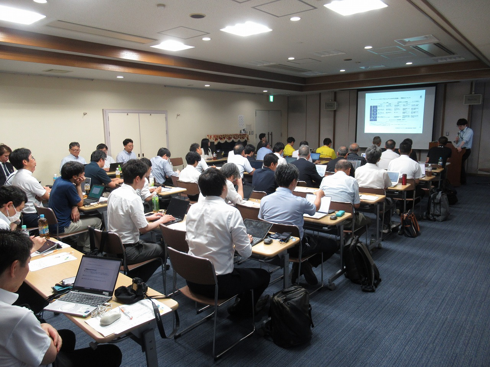
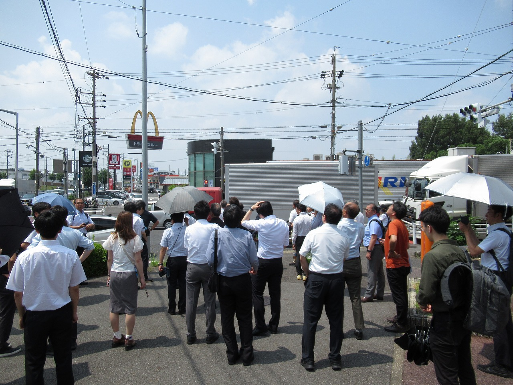
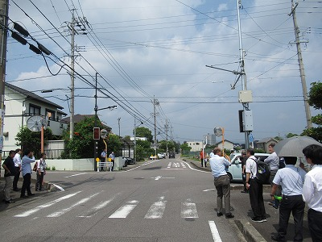

2025年7月4日（金）に豊田市・末野原交流館　大会議室にて第2回研究会を開催しました． 
多数ご参加頂き誠にありがとうございました．
<!--　-->

会場の様子

大交差点におけるスマートポール見学

住宅街におけるスマートポール見学

<!--
<table align="center" width="300">
  <tr>
    <td align="center"></td> <td align="center"></td> <td align="center"></td>
  </tr>
  <tr>
    <td align="center"> 会場の様子 </td> <td align="center">大交差点におけるスマートポール見学</td><td align="center">住宅街におけるスマートポール見学</td>
  </tr>
</table>
-->

<!--  -->

プログラムは[第2回研究会](/news/20250118-2nd-AA-ITS-Workshop/)のページをご覧ください．

パネル討論のセッションでは当初予定していました時間を大幅に超える白熱した議論が交わされました． 
いくつかリクエストを頂きましたので，パネラーの方々の投影資料を無料で公開しております． 

こちらでどうぞ（https://www.ieice.org/cs/aa-its/program/program20250704.html)

