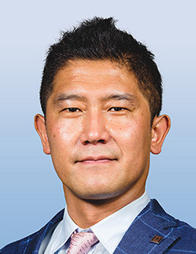

### [Go to Japanese page](/news/20260528-4th-AA-ITS-Workshop/)
---

# Overview

* **Dates:** December 3 – 4, 2026 (Updated from May)
* **Venue:** [III Building, 14th Floor, No. 133, Section 4, Minsheng East Road, Taipei City, Taiwan](https://www.iii.org.tw/en)
* **Registration Fee (Tentative):** 30,000 – 40,000 JPY (Online: 5,000 JPY)
* *Note: Field visits, corporate exhibitions, and demonstrations will not be live-streamed; online access covers selected portions of the workshop only.*

---

## Program

## Day 1: December 3 (Thursday) — Academic Session & Keynotes

* **13:00 - 13:30** Reception
* **13:30 - 13:50** Opening Remarks
* **13:50** Invited Lectures (3 presentations)
* **14:50** Break
* **15:00** Invited Lectures (3 presentations)
* **16:00** Break
* **16:20** Panel Discussion
* **17:20** Closing Remarks
* **17:30** Corporate Exhibition & Poster Session
* **18:30** Adjourn

*(Featuring 3 invited speakers from Japan and 3 from Taiwan)*

# Keynote Presentations
---

* **Heishiro Toyoda** (Human & Life Integrated Technology Dept., Advanced Mobility System Development Div., Toyota Motor Corporation)
* **Title:** Traffic Digital Twin as a Socio-technical System Aimed at Achieving Zero Traffic Accidents
* **Abstract:** Although traffic accidents and fatalities have declined over the long term, recent progress has shown signs of leveling off. Achieving zero traffic accidents therefore requires a broader approach that extends beyond improvements in vehicle safety and regulations. This presentation proposes a traffic digital twin as a human-centered socio-technical system that integrates road users, vehicles, and infrastructure, with particular emphasis on identifying and reducing near-miss events before they develop into accidents.

---

* **Kei Sakaguchi** (Program Director, Innovative-Life Society Visionary Initiative, Dean, Academy of Super Smart Society, Professor, Dept. Electrical & Electronic Engineering, Institute of Science Tokyo, Japan)
* **Title:** Hybrid Autonomous Driving enabled by Smart Mobility Digital Twin
* **Abstract:** Autonomous driving is expected to play a key role in future smart mobility systems. However, conventional autonomous vehicles rely primarily on onboard sensors and intelligence, which face fundamental limitations in perceiving occluded objects, predicting complex traffic situations, and ensuring safety in dynamic urban environments. To overcome these challenges, we have developed a novel framework for *Hybrid Autonomous Driving enabled by Smart Mobility Digital Twin*, integrating connected vehicles, intelligent roadside infrastructure, wireless communications, and artificial intelligence.

---

## Day 2: December 4 (Friday) — Smart Pole Technical Tour

* **08:20** Gathering & Departure (Meet at the III Building, depart by chartered bus)
* **09:00** Tour Site 1: Songshan Cultural and Creative Park
* **11:00** Tour Site 2: Sanchong Unsignalized Intersection, New Taipei City
* **12:30 approx.** Stopover (Drop-off at Taipei Songshan Airport for participants returning to Japan, if applicable)
* **13:20** Tour Site 3: Bureau of Standards, Metrology and Inspection (BSMI) Xizhi Building
* *(Exploring additional visits to Taiwan's electronics industry enterprises)*
* **Evening** Disbandment

---

## Registration & Submission

* **Participation Registration (Deadline: October 23):** Please register via the [Google Form](https://docs.google.com/forms/d/e/1FAIpQLSd9ttFz8gakDgKJCHk-LyIJJrp2hvKo_qOUEFXpWOOHaUAdTA/viewform?usp=dialog).
* *If you encounter issues, contact `aa-its-core [at] mail.ieice.org` with your name, affiliation, email, participation category, registration type, and format (in-person/online).*

* **Corporate Exhibition:** Interested exhibitors should contact `aa-its-core [at] mail.ieice.org`.
* **Poster Session (Deadline: October 23):**
* General poster presentations will be held in English.
* Authors must also register their presentation via the [Technical Committee System](https://ken.ieice.org/ken/program/index.php?tgid=IEICE-AA-ITS).
* Final manuscript submission (1 to 6 A4 pages using the [Technical Committee Style Files](https://www.ieice.org/jpn_r/event/kenkyukai/index.html)) is due by Friday, November 27.

---

