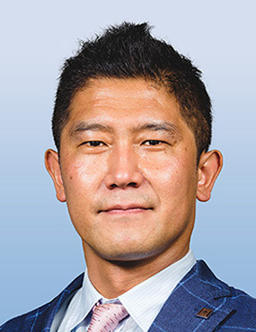

[2026.09.27 update]
<h3>(開催日が５月から変更となりました)</h3>

# 【日時】2026年12月3日～4日 (updated)
# 【会場】財団法人資訊工業策進会（III）building  
## （台湾台北市民生東路4段133号14階）
# 【参加費（予定）】30,000 ～ 40,000 JPY（オンライン参加 5,000 JPY）
　※オンライン参加について，現地視察，企業展示，デモなどのオンライン配信は致しません．研究会の一部のみの配信となりますこと，ご了承ください．
# 【プログラム（予定）】
## 1日目（12月3日（木））
- 13:00-13:30 受付
- 13:30-13:50 開会挨拶
- 13:50 招待講演3件
- 14:50 休憩
- 15:00 招待講演3件
- 16:00 休憩
- 16:20 パネル討論
- 17:20 挨拶
- 17:30 企業展示・ポスターセッション
- 18:30 閉会

招待講演は日本3件，台湾3件を予定．

<table style="width: 100%; table-layout: fixed; border-collapse: collapse; border: 1px solid #000;">
  <colgroup>
    <col style="width: 20%;">
    <col style="width: 60%;">
    <col style="width: 20%;">
  </colgroup>
    <thead style="background-color: #f0f0f0;">
    <tr>
      <th style="border: 1px solid #000; padding: 8px;">Presenter</th>
      <th style="border: 1px solid #000; padding: 8px;">Title, Abstract</th>
      <th style="border: 1px solid #000; padding: 8px;">Photograph</th>
    </tr>
  </thead>
  <tbody>
    <!-- Speaker 1 -->
    <tr>
      <td style="border: 1px solid #000; padding: 8px;">
        <strong>Heishiro Toyoda</strong> 
        Toyota Motor Corporation
      </td>
      <td style="border: 1px solid #000; padding: 8px;">
        <strong>Traffic Digital Twin as a Socio-technical System Aimed at Achieving Zero Traffic Accidents</strong>  
        Although traffic accidents and fatalities have declined over the long term, recent progress has shown signs of leveling off. Achieving zero traffic accidents therefore requires a broader approach that extends beyond improvements in vehicle safety and regulations. This presentation proposes a traffic digital twin as a human-centered socio-technical system that integrates road users, vehicles, and infrastructure, with particular emphasis on identifying and reducing near-miss events before they develop into accidents.
        
        The proposed system continuously observes traffic environments using infrastructure and vehicle sensors, integrates heterogeneous data within a digital representation, and predicts multiple plausible future scenarios. Potential risks are identified by modeling the movements and interactions of vehicles, pedestrians, cyclists, and other road users. The system then communicates these risks in ways that help individuals understand possible future events and voluntarily choose safer behavior, rather than simply imposing warnings or control.
        
        Five technology areas are essential to this concept: timely and comprehensive sensing of traffic conditions; integration and digital representation of heterogeneous data; behavior modeling for short- and longer-term prediction; human–machine interfaces that promote understanding and behavioral change; and scalable communication and computing architectures. Initial development focuses on high-risk intersections, using real-world sensor data, simulation, vision-language understanding, and dynamic-occlusion analysis to predict near-miss scenarios.
        
        The long-term objective is to expand the deployment scope from individual intersections to multiple intersections and eventually entire urban areas. Through repeated support for risk anticipation, the traffic digital twin is expected to prevent immediate conflicts and, more importantly, cultivate individuals’ hazard-anticipation capabilities. Ultimately, it aims to provide a shared social infrastructure in which people and technology collaboratively create safer and more efficient traffic environments.
      </td>
      <td style="border: 1px solid #000; padding: 8px; text-align: center;">
        
      </td>
    </tr>
    <!-- Speaker 2 -->
    <tr>
      <td style="border: 1px solid #000; padding: 8px;">
        <strong>Kei Sakaguchi</strong> 
        Institute of Science Tokyo, Japan
      </td>
      <td style="border: 1px solid #000; padding: 8px;">
        <strong>Hybrid Autonomous Driving enabled by Smart Mobility Digital Twin</strong>  
        Autonomous driving is expected to play a key role in future smart mobility systems. However, conventional autonomous vehicles rely primarily on onboard sensors and intelligence, which face fundamental limitations in perceiving occluded objects, predicting complex traffic situations, and ensuring safety in dynamic urban environments. To overcome these challenges, we have developed a novel framework for *Hybrid Autonomous Driving enabled by Smart Mobility Digital Twin*, integrating connected vehicles, intelligent roadside infrastructure, wireless communications, and artificial intelligence.
        
        The Smart Mobility Digital Twin continuously collects real-time information about traffic participants, including vehicles, pedestrians, and cyclists, through V2X communications and roadside sensing infrastructure. This information is integrated into a digital representation of the physical traffic environment, enabling cooperative perception beyond the capabilities of individual vehicles. Furthermore, AI-based prediction technologies anticipate future movements of traffic participants and potential collision risks, allowing the digital twin to provide proactive driving assistance and safety-critical information to autonomous vehicles.
        
        This approach extends conventional vehicle-centric autonomous driving toward an infrastructure-assisted, cooperative intelligence architecture, where physical and cyber systems interact in real time. It also creates new opportunities for improving traffic efficiency, enhancing the reliability of V2X communications, and enabling safer mobility in complex urban environments.
        
        In this keynote, we will introduce the fundamental concepts, enabling technologies, and system architecture of Smart Mobility Digital Twin and Hybrid Autonomous Driving. We will also present recent research developments and experimental demonstrations conducted at the Ookayama Smart Mobility Test Field in Tokyo, and discuss future directions toward the integration of 6G communications, Physical AI, and next-generation intelligent transportation system.
      </td>
      <td style="border: 1px solid #000; padding: 8px; text-align: center;">
        
      </td>
    </tr>
  </tbody>
</table>

## 2日目（12月4日（金））
スマートポール見学会
- 08:20 【集合・移動】IIIビル集合，貸し切りバスにて移動開始
- 09:00 【見学①】松山文創園区
- 11:00 【見学②】新北三重・無信号交差点
- 12:30頃　※帰国される日本側参加者がもしいれば台北松山空港立ち寄り
- 13:20 【見学③】標準検査局（BSMI）汐止ビル
- ※台湾電子産業に関連する企業見学も打診中
- その後，夕刻散会予定

# 参加申し込み（10月23日〆切）
<a href="https://docs.google.com/forms/d/e/1FAIpQLSd9ttFz8gakDgKJCHk-LyIJJrp2hvKo_qOUEFXpWOOHaUAdTA/viewform?usp=dialog" target="_blank">　Google form</a>からご登録ください．  

※formの利用に問題がある場合はメール（宛先：aa-its-core [at] mail.ieice.org）で以下の内容をご連絡ください．
- 氏名，ご所属，メールアドレス
- 参加種別（発表者（登壇者） or 発表者（共著者） or 聴講者）
- 登録種別（学会員 or 非会員 or 学生）
- 参加形態（現地参加 or オンライン参加）※現地視察，企業展示，デモなどのオンライン配信は致しません．研究会の一部のみの配信となりますこと，ご了承ください

# 企業展示について
エントリーを希望される方はメール（宛先：aa-its-core [at] mail.ieice.org）でご連絡ください．

# ポスターセッションについて（10月23日〆切）
一般講演発表としてポスターセッションを予定しています．
ご発表いただける方は，上記参加申し込みに加え，発表を<a href="https://ken.ieice.org/ken/program/index.php?tgid=IEICE-AA-ITS" target="_blank">研究会システム</a>で登録ください．

- ポスター形式による発表
- 発表言語は英語
- A4 1枚～6枚の予稿（<a href="https://www.ieice.org/jpn_r/event/kenkyukai/index.html" target="_blank">研究会スタイルファイル</a>を利用ください）を別途提出（11月27日（金）締切）

--

