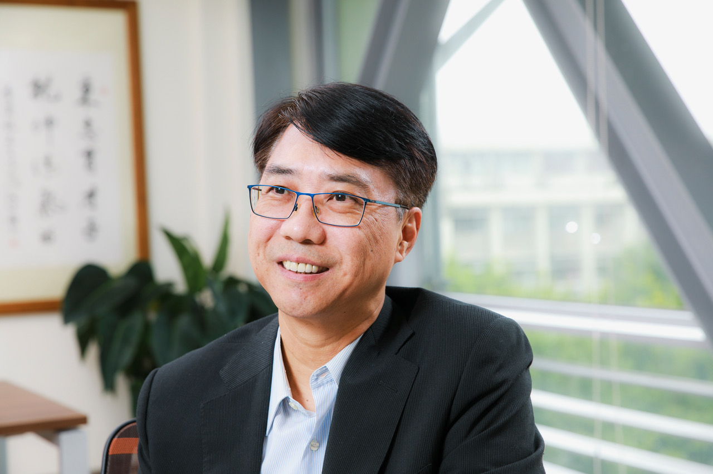

[2026.10.20 update]

### [Go to English page](/news/20260528-4th-AA-ITS-Taiwan-Workshop/)

<h3>(開催日が５月から変更となりました)</h3>

# 【日時】 2026年12月3日～4日 (updated)
# 【会場】 [財団法人資訊工業策進会（III）building](https://www.iii.org.tw/en)
## （台湾台北市民生東路4段133号14階）
# 【参加費（予定）】30,000 ～ 40,000 JPY（オンライン参加 5,000 JPY）
　※オンライン参加について，現地視察，企業展示，デモなどのオンライン配信は致しません．研究会の一部のみの配信となりますこと，ご了承ください．
# 【プログラム（予定）】
## 1日目（12月3日（木））
- 13:00-13:30 受付
- 13:30-13:50 開会挨拶
- 13:50 招待講演3件
- 14:50 休憩
- 15:00 招待講演3件
- 16:00 休憩
- 16:20 パネル討論
- 17:20 挨拶
- 17:30 企業展示・ポスターセッション
- 18:30 閉会

招待講演は日本3件，台湾3件を予定．

# Keynote Presentations
---

* **Heishiro Toyoda** (Human & Life Integrated Technology Dept., Advanced Mobility System Development Div., Toyota Motor Corporation)
* **Title:** Traffic Digital Twin as a Socio-technical System Aimed at Achieving Zero Traffic Accidents
* **Abstract:** Although traffic accidents and fatalities have declined over the long term, recent progress has shown signs of leveling off. Achieving zero traffic accidents therefore requires a broader approach that extends beyond improvements in vehicle safety and regulations. This presentation proposes a traffic digital twin as a human-centered socio-technical system that integrates road users, vehicles, and infrastructure, with particular emphasis on identifying and reducing near-miss events before they develop into accidents.

---

* **Kei Sakaguchi** (Program Director, Innovative-Life Society Visionary Initiative, Dean, Academy of Super Smart Society, Professor, Dept. Electrical & Electronic Engineering, Institute of Science Tokyo, Japan)
* **Title:** Hybrid Autonomous Driving enabled by Smart Mobility Digital Twin
* **Abstract:** Autonomous driving is expected to play a key role in future smart mobility systems. However, conventional autonomous vehicles rely primarily on onboard sensors and intelligence, which face fundamental limitations in perceiving occluded objects, predicting complex traffic situations, and ensuring safety in dynamic urban environments. To overcome these challenges, we have developed a novel framework for *Hybrid Autonomous Driving enabled by Smart Mobility Digital Twin*, integrating connected vehicles, intelligent roadside infrastructure, wireless communications, and artificial intelligence.

* **Henry Meng** (Chief Research and Development Officer, Institute for Information Industry, Taiwan)
* **Title:** Smart Pole Empowering Two-Wheeler Safety: AI Roadside Perception and Real-Time Risk Warning
* **Abstract:** This presentation explores innovative applications of smart poles to enhance the safety of two-wheeler riders and vulnerable road users. It introduces how the Institute for Information Industry (III) leverages smart sensing and Vehicle-to-Everything (V2X) technologies to integrate roadside environmental perception, traffic risk detection, and real-time information delivery. These capabilities help drivers identify blind spots and potential collision risks earlier, improving safety alerts at intersections. By integrating intelligent roadside infrastructure with cooperative vehicle-infrastructure systems, the approach extends the perception capabilities of conventional in-vehicle systems and provides enhanced safety protection for motorcyclists, cyclists, and pedestrians, demonstrating the potential of Taiwan’s intelligent transportation technologies to improve road safety.

* **Rick Chang** (Associate Vice President, Smart City Solutions, Far EasTone Telecommunications Co., Ltd. (FET), Taiwan)
* **Title:** Smart Poles: Building a Citywide Safety Network
* **Abstract:** This presentation explores how smart poles integrate street lighting, surveillance, and sensors to serve as urban sensing and citizen service nodes, enhancing urban resilience and public services. It introduces a four-layer architecture comprising Perception, Connectivity, AI Analytics, and Services, with digital twin applications incorporated into the services layer. Deployment is tailored to the characteristics and needs of commercial districts, transportation hubs, traffic corridors, and campuses. Key applications include traffic optimization, air quality monitoring, and water-related alerts, demonstrating how smart poles can support urban management and citizen services across different settings. The presentation also discusses de-identification and tiered cybersecurity governance to protect data privacy and manage cybersecurity risks. Finally, it examines how attracting visitors to local commercial districts can support sustainable operating models for smart pole services.

* 

* **Bing-Jean Lee** (Distinguished Chair Professor, Director, Office of Technology Development, Director, FCU-MIC Smart City 5G Laboratory, Feng Chia University, Taiwan)
* **Title:** A New Hub for Smart Cities: Transforming Urban Governance and Industrial Development through Smart Poles
* **Abstract:** To overcome the challenges of data silos and duplicated infrastructure in traditional smart cities, deploying "Smart Poles" as urban neural endpoints and data hubs offers a transformative solution. Equipped with modular attachments, 5G connectivity, and Edge AI capabilities, these poles emulate human sensory systems—sensing visuals, sounds, air quality, and broadcasting real-time information. A Public-Private Partnership (PPP) model, combining a 5-year BTO with a 10-year ROT structure, ensures long-term financial sustainability. Under this framework, local governments retain ownership of the pole structures and data, while granting a Special Purpose Vehicle (SPV) rights to operate attached services and commercialize insights. Furthermore, a cross-departmental data governance platform powered by Sovereign AI connects fragmented agency databases, driving smarter city management. Practical applications range from automated traffic signal preemption for emergency vehicles using acoustic tracking, to proactive safety alerts for fall detection and privacy-compliant hyper-local commercial push notifications via 5G micro-base stations. Starting with an initial deployment of 1,000 poles, this strategic approach unlocks scalable AI governance and sustainable commercial value for modern smart cities.

---

## 2日目（12月4日（金））
スマートポール見学会（予定）
- 08:20 【集合・移動】IIIビル集合，貸し切りバスにて移動開始
- 09:00 【見学①】松山文創園区
- 11:00 【見学②】新北三重・無信号交差点
- 12:30頃　※帰国される日本側参加者がもしいれば台北松山空港立ち寄り
- 13:20 【見学③】標準検査局（BSMI）汐止ビル
- 16:00 【見学④】電子産業企業訪問調整中
- 18:00 IIIビル解散

# 参加申し込み（10月23日〆切）
<a href="https://docs.google.com/forms/d/e/1FAIpQLSd9ttFz8gakDgKJCHk-LyIJJrp2hvKo_qOUEFXpWOOHaUAdTA/viewform?usp=dialog" target="_blank">　Google form</a>からご登録ください．  

※formの利用に問題がある場合はメール（宛先：aa-its-core [at] mail.ieice.org）で以下の内容をご連絡ください．
- 氏名，ご所属，メールアドレス
- 参加種別（発表者（登壇者） or 発表者（共著者） or 聴講者）
- 登録種別（学会員 or 非会員 or 学生）
- 参加形態（現地参加 or オンライン参加）※現地視察，企業展示，デモなどのオンライン配信は致しません．研究会の一部のみの配信となりますこと，ご了承ください

# 企業展示について
エントリーを希望される方はメール（宛先：aa-its-core [at] mail.ieice.org）でご連絡ください．

# ポスターセッションについて（10月23日〆切）
一般発表としてポスターセッションを予定しています．
ご発表いただける方は，上記参加申し込みに加え，発表を<a href="https://ken.ieice.org/ken/program/index.php?tgid=IEICE-AA-ITS" target="_blank">研究会システム</a>で登録ください．

- ポスター形式による発表
- 言語は英語
- A4 1枚～6枚の予稿（<a href="https://www.ieice.org/jpn_r/event/kenkyukai/index.html" target="_blank">研究会スタイルファイル</a>を利用ください）を別途提出（11月27日（金）締切）

--

