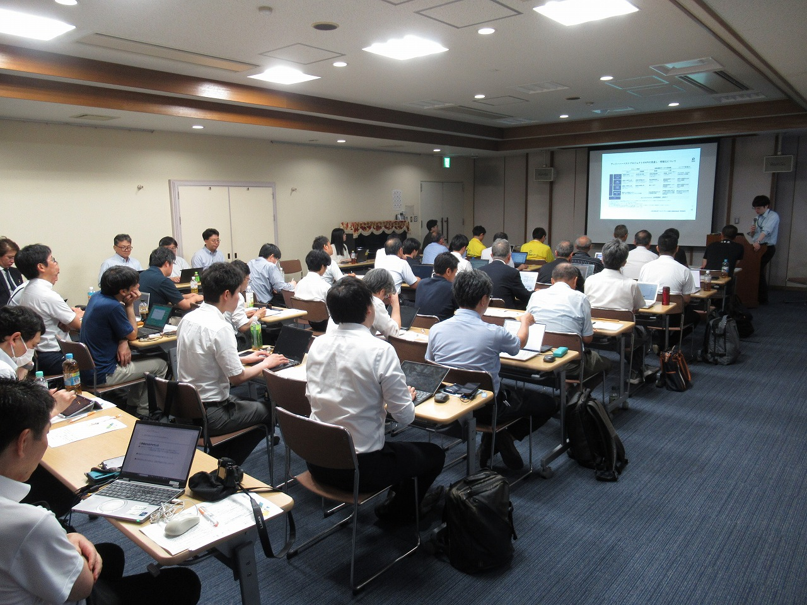
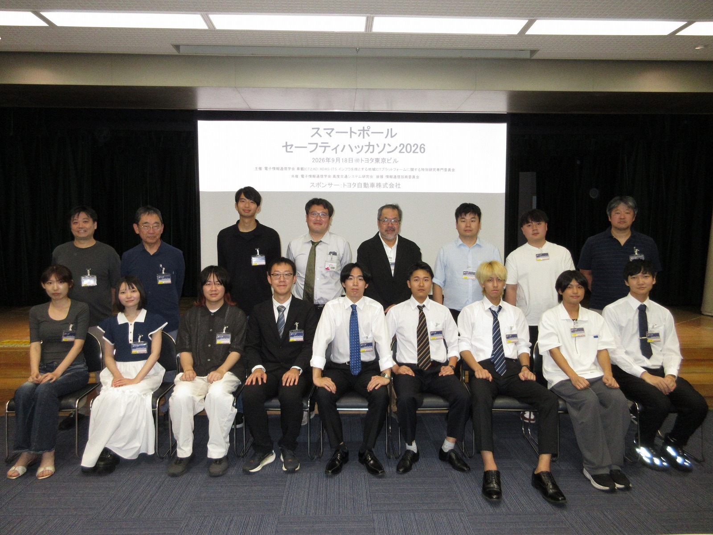
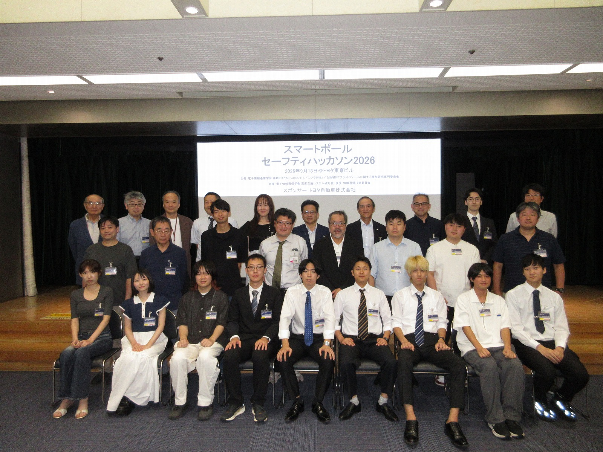
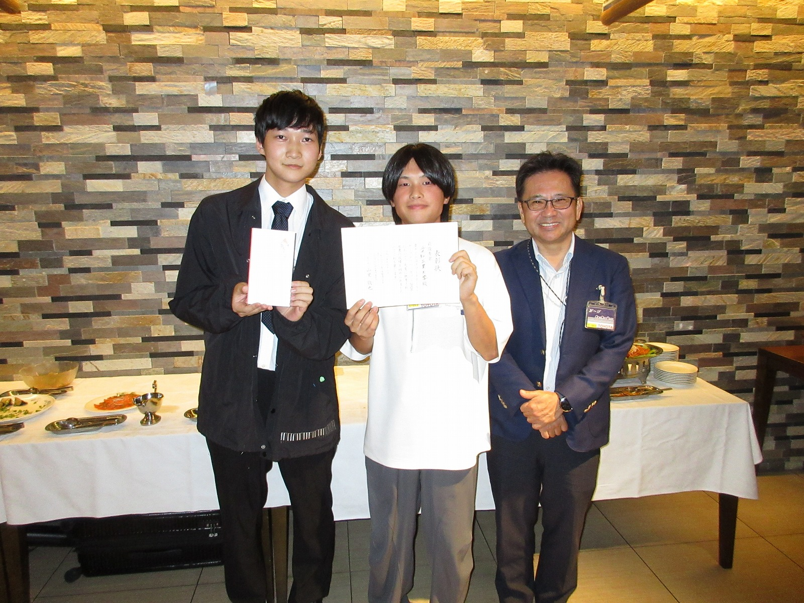
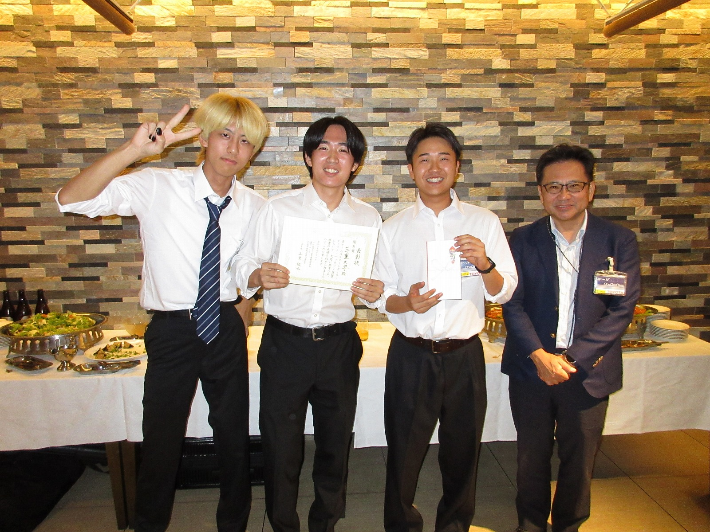
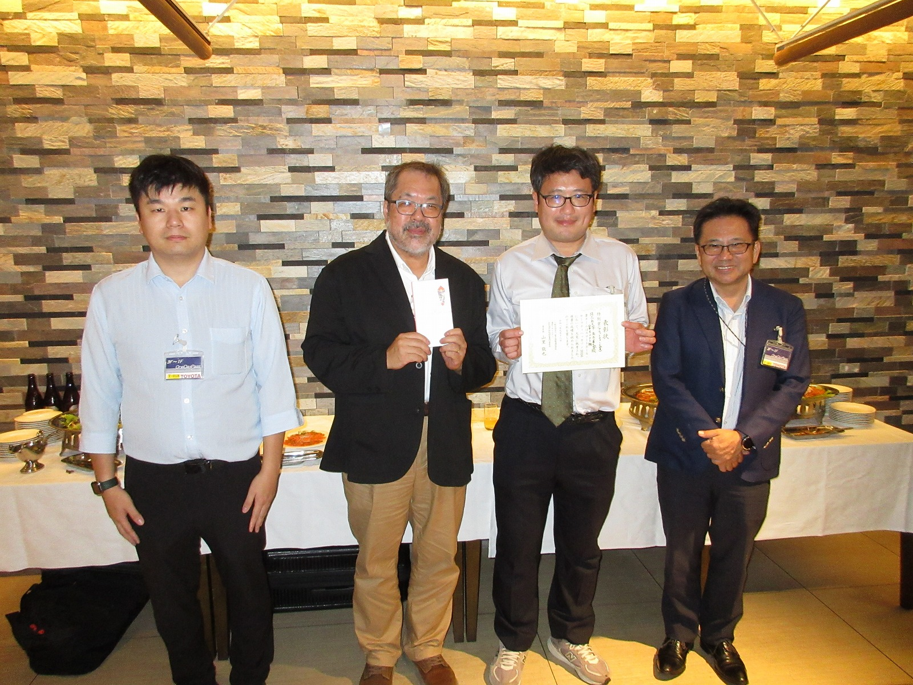
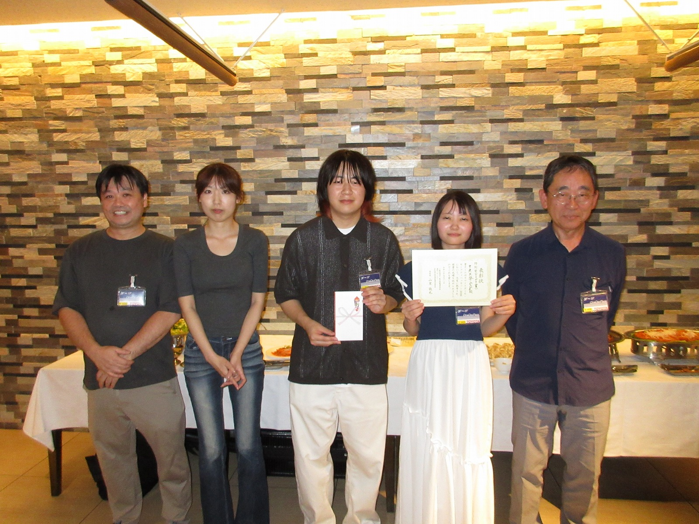
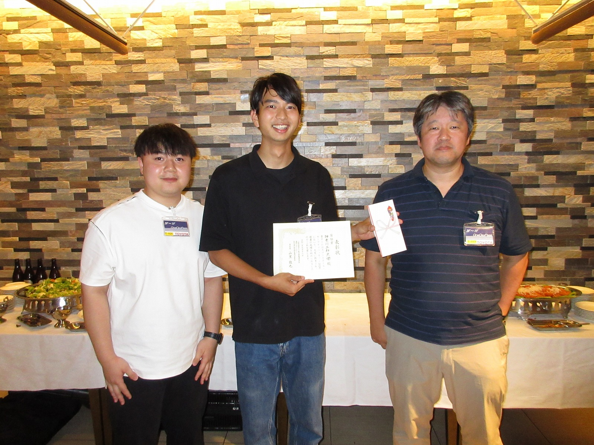
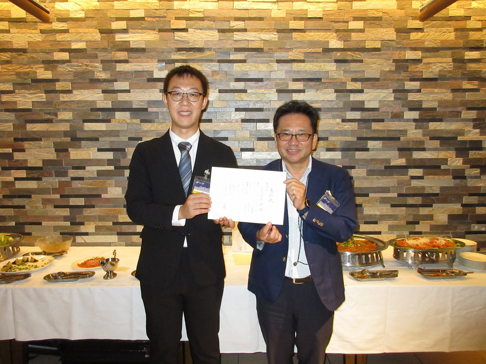

2026年9月18日（金）にトヨタ東京ビルにてスマートポール・セーフティハッカソン2026を開催しました． 
多数ご参加頂き誠にありがとうございました．

プログラムは[スマートポール・セーフティハッカソン2026](/news/20260917-AA-ITS-Safety-Hachathon/)のページをご覧ください．

次年度も開催する予定です．
皆様のご参加，心よりお待ち申し上げます．

<!-- -->
 # 写真
<table style="border: none !important; border-collapse: collapse;">
  <tr style="border: none !important;">
    <td style="border: none !important; width: 300px; padding: 5px;"></td>
    <td style="border: none !important; width: 300px; padding: 5px;"></td>
  </tr>
  <tr style="border: none !important;">
    <td style="border: none !important; width: 300px; padding: 5px;"></td>
    <td style="border: none !important; width: 300px; padding: 5px;"></td>
  </tr>
  <tr style="border: none !important;">
    <td style="border: none !important; width: 300px; padding: 5px;"></td>
    <td style="border: none !important; width: 300px; padding: 5px;"></td>
  </tr>
  <tr style="border: none !important;">
    <td style="border: none !important; width: 300px; padding: 5px;"></td>
    <td style="border: none !important; width: 300px; padding: 5px;"></td>
  </tr>
  <tr style="border: none !important;">
    <td style="border: none !important; width: 300px; padding: 5px;"></td>
    <td style="border: none !important; width: 300px; padding: 5px;"></td>
  </tr>
  <tr style="border: none !important;">
    <td style="border: none !important; width: 300px; padding: 5px;"></td>
    <td style="border: none !important; width: 300px; padding: 5px;"></td>
  </tr>
</table>

 # 受賞グループ

<table style="width: 100%; table-layout: fixed;">
  <colgroup>
    <col style="width: 10%;">
    <col style="width: 30%;">
    <col style="width: 30%;">
    <col style="width: 30%;">
  </colgroup>
  <thead>
    <tr>
      <th>賞</th>
      <th>名前</th>
      <th>発表題目</th>
      <th>写真</th>
    </tr>
  </thead>
  <tbody>
    <tr>
      <td>最優秀賞</td>
      <td>柴田 大輝(愛知工業大学)，鈴木 海平(愛知工業大学)</td>
      <td>スマートポールから得られる軌跡データを活用したTransformerによる車両の軌跡推定</td>
      <td></td>
    </tr>
    <tr>
      <td>優秀賞</td>
      <td>福田 大瑛(三重大学)，森 新汰(三重大学)，加藤 瑞稀(三重大学)</td>
      <td>スムーズな交差点通行を実現「スムクロ」の提案</td>
      <td></td>
    </tr>
    <tr>
      <td>審査員特別賞（プラットフォーム賞）</td>
      <td>草山 真一(名古屋大学)，佐藤 健哉(同志社大学)，小林 玄武(富士ソフト株式会社)，山田 峻也(名古屋大学)</td>
      <td>情報通信プラットフォームを利用した多様なアプリケーションの実現 -遠隔監視，衝突危険警告から走行調停，道路課金まで-</td>
      <td></td>
    </tr>
    <tr>
      <td>審査員特別賞（アイデア賞）</td>
      <td>伊藤 篤(中央大学)，高橋淳奈(中央大学)，ヘンミセン(中央大学)，田中 侑也(中央大学)，駒村 拓哉(中央大学)，佐々木 陽(（株）Gclue</td>
      <td>スマートポールによる見守りネットワークの構築</td>
      <td></td>
    </tr>
    <tr>
      <td>奨励賞</td>
      <td>谷脇 小太郎(神奈川工科大学)，盛百立(神奈川工科大学)，高取 祐介(神奈川工科大学)</td>
      <td>見通しの良し悪しによる交差点の侵入の違いについて</td>
      <td></td>
    </tr>
    <tr>
      <td>奨励賞</td>
      <td>YANG HAORAN(名古屋大学)</td>
      <td>スマートポールの実測データに基づく衝突防止のための通知タイミングの検討 -どのくらいの距離で通知すれば衝突を防止できるのか？</td>
      <td></td>
    </tr>
  </tbody>
</table>

<!--
| 賞 | 名前 | 発表題目 | |
| --- | --- | --- | --- |
| 最優秀賞 | 柴田 大輝(愛知工業大学)，鈴木 海平(愛知工業大学) | スマートポールから得られる軌跡データを活用したTransformerによる車両の軌跡推定 | |
| 優秀賞 | 福田 大瑛(三重大学)，森 新汰(三重大学)，加藤 瑞稀(三重大学) | スムーズな交差点通行を実現「スムクロ」の提案 |  |
| 審査員特別賞（プラットフォーム賞） | 草山 真一(名古屋大学)，佐藤 健哉(同志社大学)，小林 玄武(富士ソフト株式会社)，山田 峻也(名古屋大学) | 情報通信プラットフォームを利用した多様なアプリケーションの実現 -遠隔監視，衝突危険警告から走行調停，道路課金まで- | |
| 審査員特別賞（アイデア賞） | 伊藤 篤(中央大学)，高橋淳奈(中央大学)，ヘンミセン(中央大学)，田中 侑也(中央大学)，駒村 拓哉(中央大学)，佐々木 陽(（株）Gclue | スマートポールによる見守りネットワークの構築 | |
| 奨励賞 | 谷脇 小太郎(神奈川工科大学)，盛百立(神奈川工科大学)，高取 祐介(神奈川工科大学) | 見通しの良し悪しによる交差点の侵入の違いについて| |
| 奨励賞 | YANG HAORAN(名古屋大学) | スマートポールの実測データに基づく衝突防止のための通知タイミングの検討 -どのくらいの距離で通知すれば衝突を防止できるのか？ || 
-->
