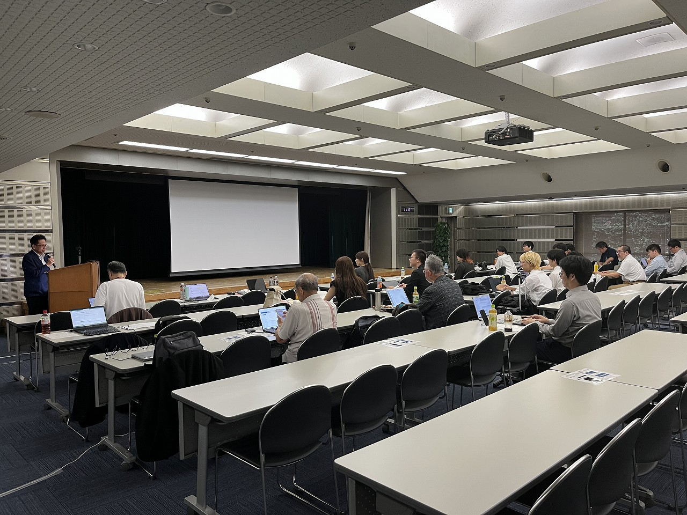
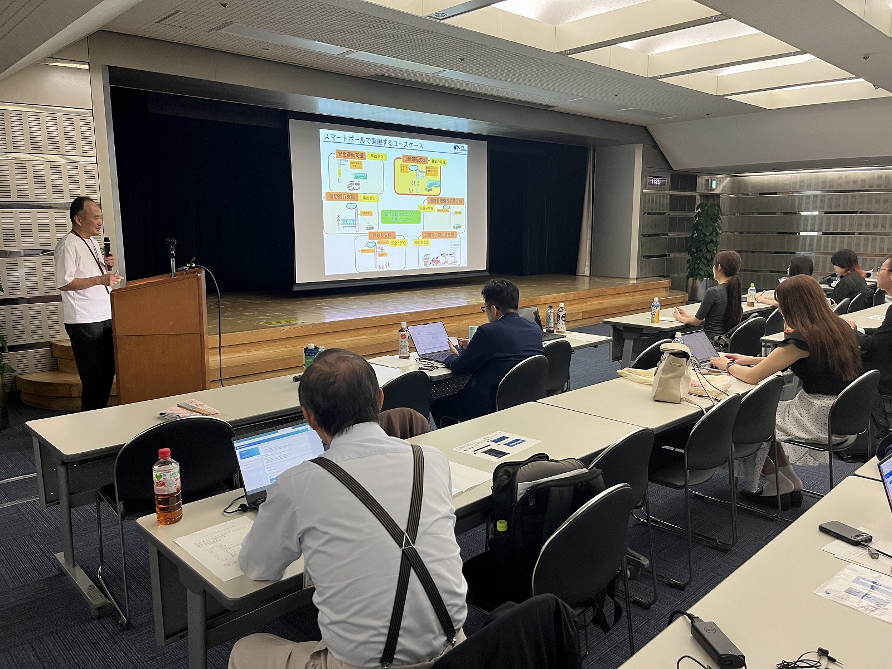
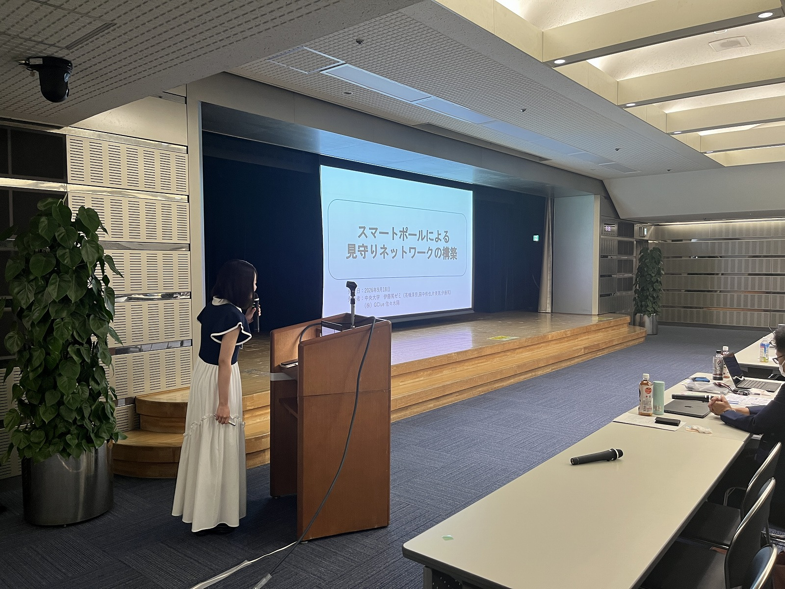
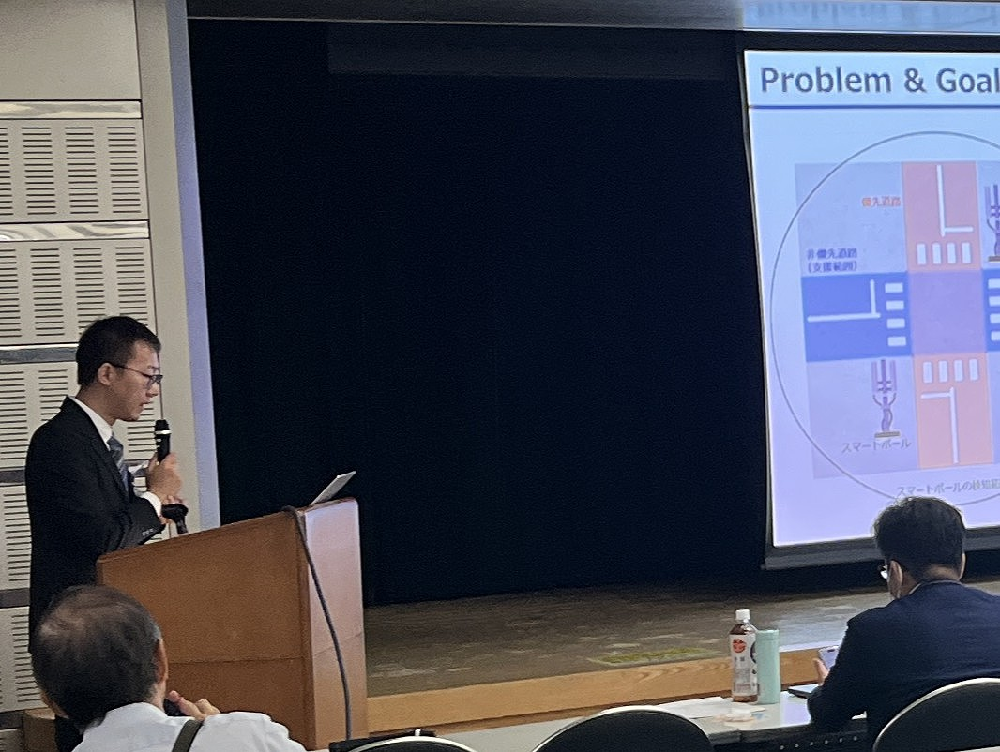
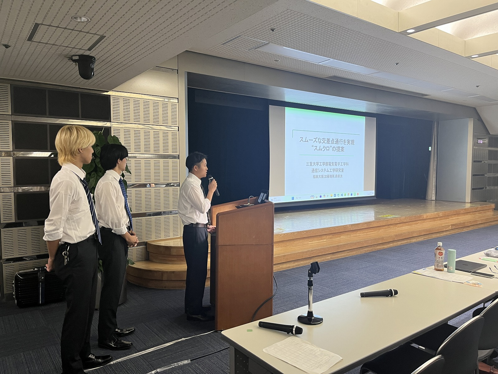
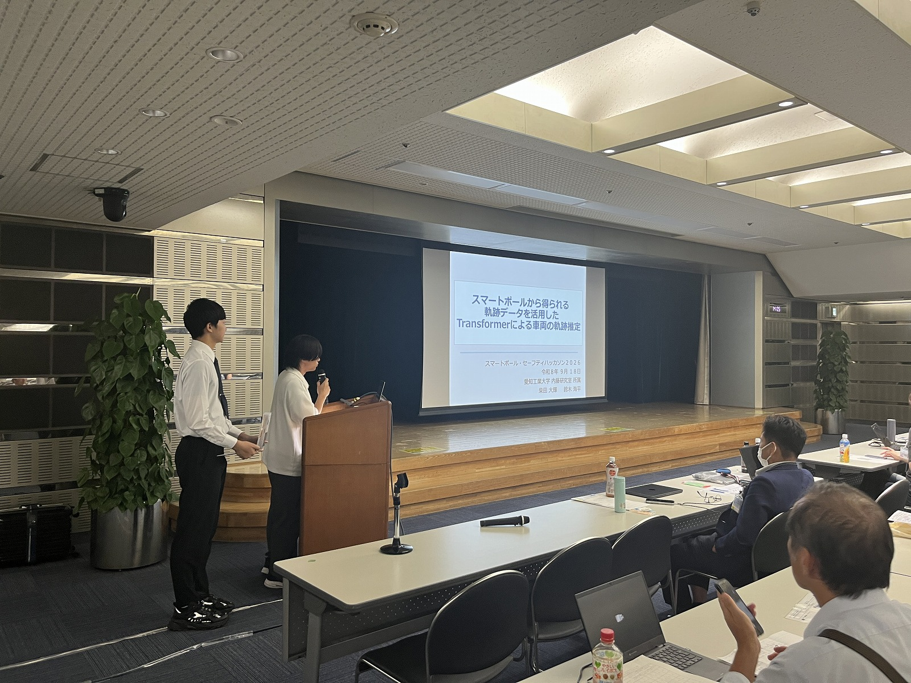
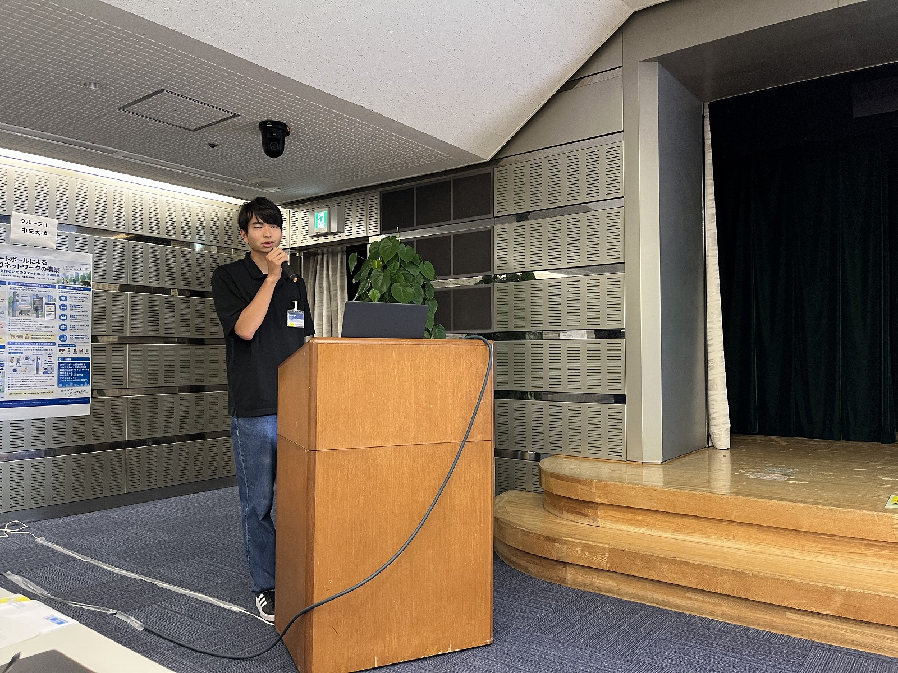
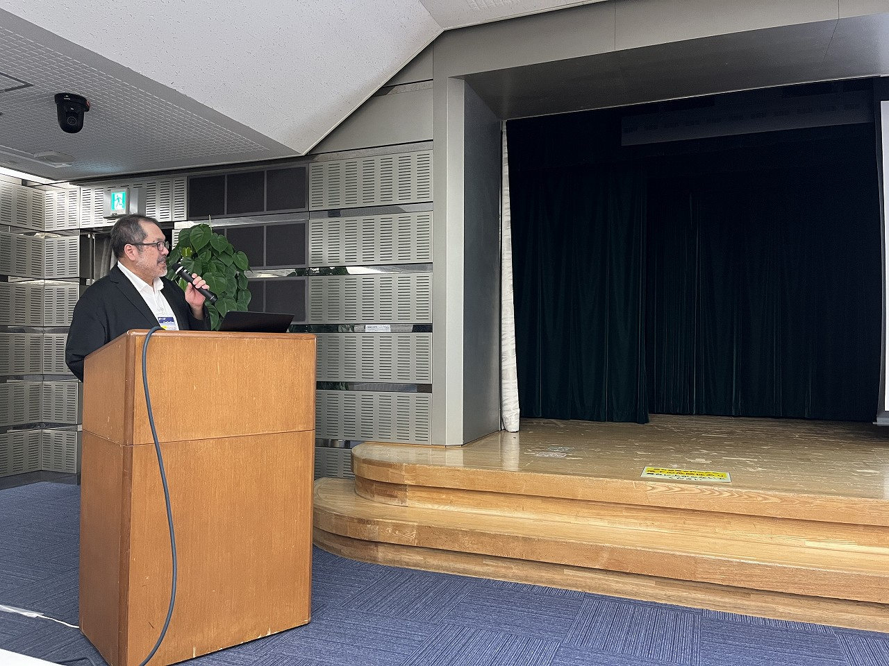
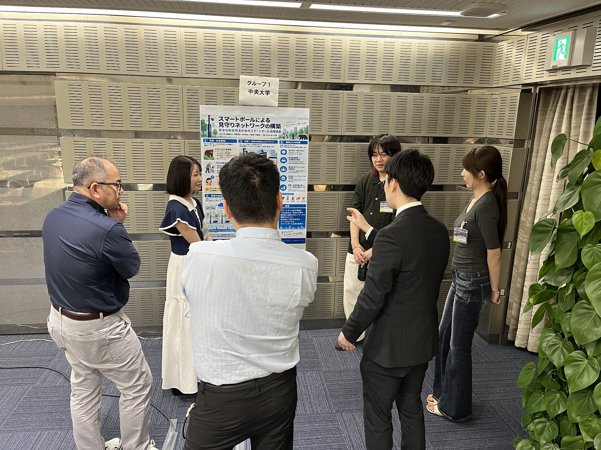
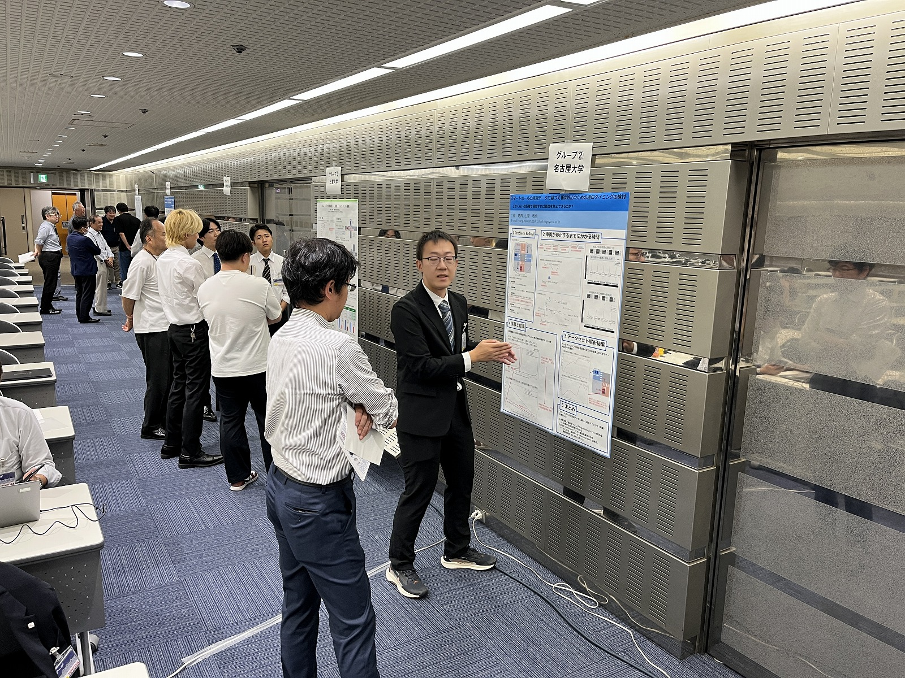

---
templateKey: blog-post
title: 【報告】スマートポール・セーフティハッカソン2026を開催しました．
date: 2026-9-18T09:00:10.000Z
description: スマートポール・セーフティハッカソン2026が無事に終わりました．ご報告．
featuredpost: false
featuredimage: /img/AA-ITS-small.webp
tags:
- スマートポール・セーフティハッカソン2026
- AA-ITS Smartpole Hackathon 2026
---

2026年9月18日（金）にトヨタ東京ビルにてスマートポール・セーフティハッカソン2026を開催しました． 
多数ご参加頂き誠にありがとうございました．
<!--　-->

  
  

  
  

  
  

  
  

  
  

プログラムは[スマートポール・セーフティハッカソン2026](/news/20260917-AA-ITS-Safety-Hachathon/)のページをご覧ください．

受賞グループ
| 賞 | 名前 | 発表題目 |
| --- | --- | --- |
| 最優秀賞 | 柴田 大輝(愛知工業大学)，鈴木 海平(愛知工業大学) | スマートポールから得られる軌跡データを活用したTransformerによる車両の軌跡推定 |
| 優秀賞 | 福田 大瑛(三重大学)，森 新汰(三重大学)，加藤 瑞稀(三重大学) | スムーズな交差点通行を実現「スムクロ」の提案 |
| 審査員特別賞（プラットフォーム賞） | 草山 真一(名古屋大学)，佐藤 健哉(同志社大学)，小林 玄武(富士ソフト株式会社)，山田 峻也(名古屋大学) | 情報通信プラットフォームを利用した多様なアプリケーションの実現 -遠隔監視，衝突危険警告から走行調停，道路課金まで- |
| 審査員特別賞（アイデア賞） | 伊藤 篤(中央大学)，高橋淳奈(中央大学)，ヘンミセン(中央大学)，田中 侑也(中央大学)，駒村 拓哉(中央大学)，佐々木 陽(（株）Gclue | スマートポールによる見守りネットワークの構築 |
| 奨励賞 | YANG HAORAN(名古屋大学) | スマートポールの実測データに基づく衝突防止のための通知タイミングの検討 -どのくらいの距離で通知すれば衝突を防止できるのか？ |
| 奨励賞 | 谷脇 小太郎(神奈川工科大学)，盛百立(神奈川工科大学)，高取 祐介(神奈川工科大学) | 見通しの良し悪しによる交差点の侵入の違いについて|

次回は2025年12月5日（金）に機械振興会館にて開催します． 
どうぞ，奮ってご参加下さい．たくさんの皆様のご参加をお待ちしております． 
詳細は[こちらから](news/20251205-AA-ITS-Workshop.md)

